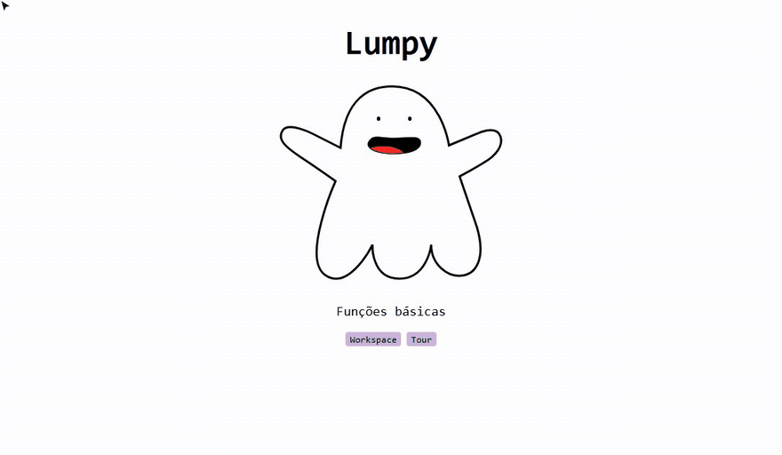
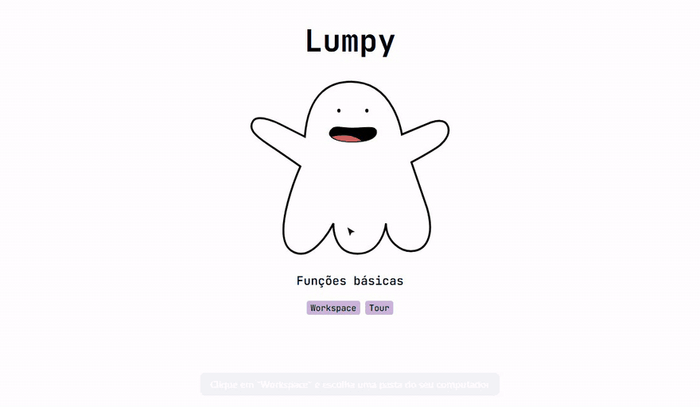
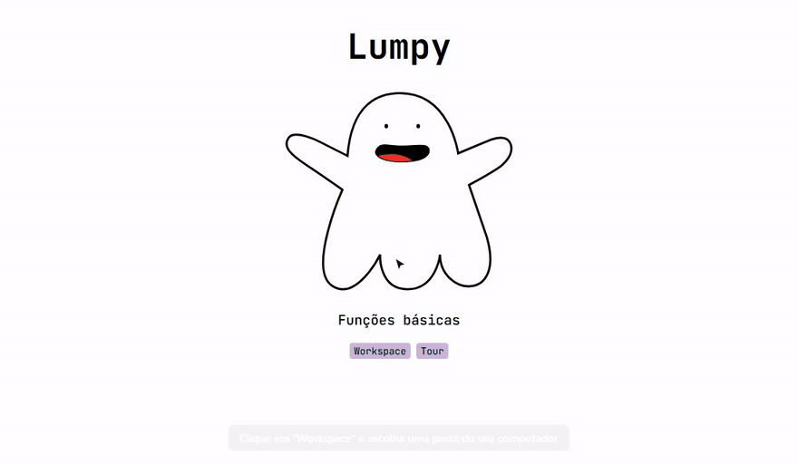
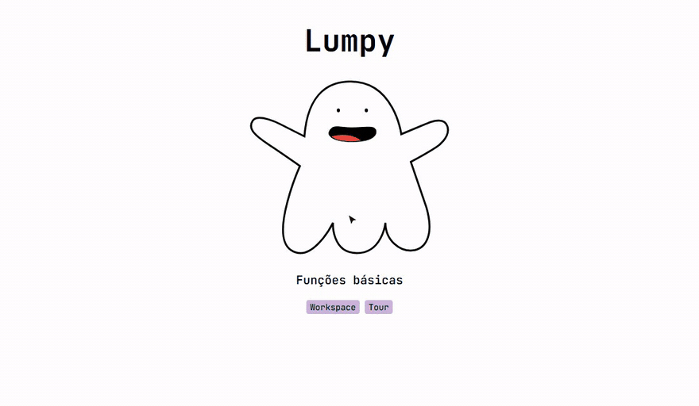
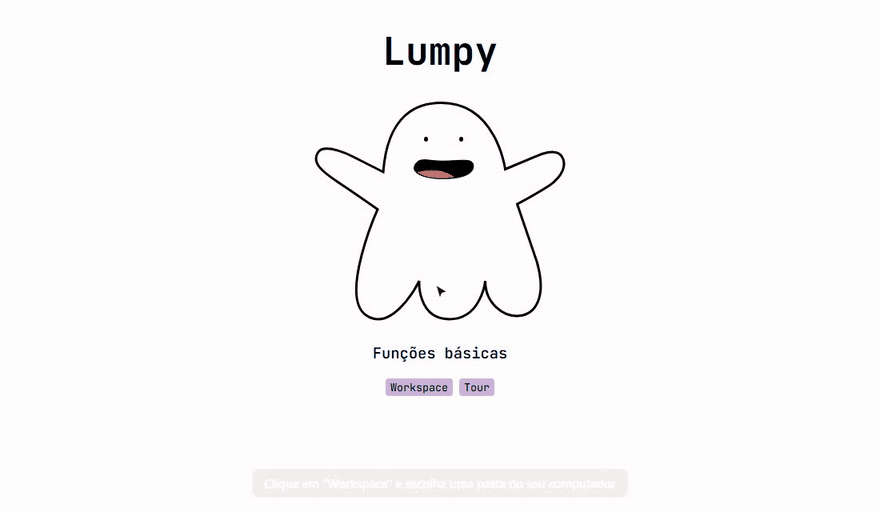
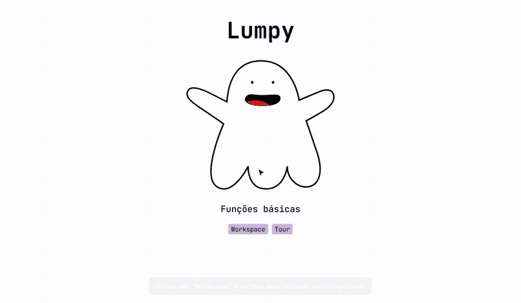
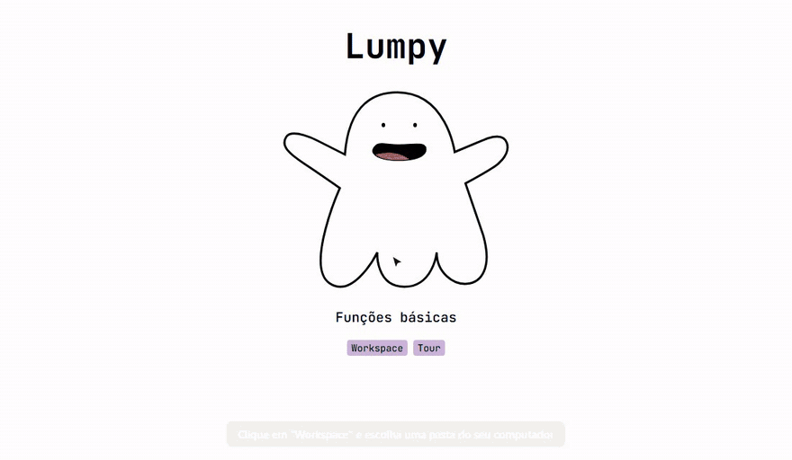
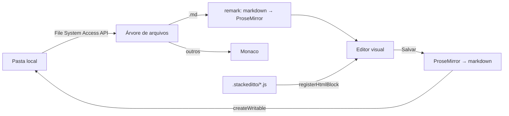

# Guia do Stackeditto

O **Stackeditto** é um editor de markdown que roda inteiro no navegador, inspirado no Obsidian. Você escolhe uma pasta do seu computador e ela vira o seu *workspace* (ou *vault*): o app lê e grava os arquivos dessa pasta diretamente, sem servidor, sem conta e sem upload.

- Versão publicada: <https://pedrohsleal.github.io/stackeditto/>
- Rodar localmente: `npm install` e depois `npm run dev`

> **Navegador:** use Chrome, Edge ou outro navegador baseado em Chromium. O app depende da [File System Access API](https://developer.mozilla.org/docs/Web/API/File_System_API), que Firefox e Safari não oferecem para pastas locais.

## Sumário

1. [Abrir uma pasta](#1-abrir-uma-pasta)
2. [Navegar entre arquivos](#2-navegar-entre-arquivos)
3. [Escrever em markdown](#3-escrever-em-markdown)
4. [Salvar](#4-salvar)
5. [Criar pastas e arquivos](#5-criar-pastas-e-arquivos)
6. [Renomear e excluir (menu do botão direito)](#6-renomear-e-excluir)
7. [Extensões](#7-extensões)
8. [O que o editor entende de markdown](#o-que-o-editor-entende-de-markdown)
9. [Como funciona por dentro](#como-funciona-por-dentro)
10. [Limitações conhecidas](#limitações-conhecidas)

---

## 1. Abrir uma pasta

Na tela inicial, clique em **Workspace**. O navegador abre o seletor de pastas do sistema e pede permissão de leitura e escrita; escolha a pasta das suas notas e confirme. A árvore de arquivos aparece na lateral esquerda.



- Clique numa **pasta** para expandir ou recolher.
- Clique num **arquivo** para abrir no editor.
- As pastas `.git` e `.obsidian` são ignoradas, então dá para abrir um vault do Obsidian.

> O seletor de pastas é uma janela do sistema operacional, por isso não aparece nos GIFs: eles começam logo depois de escolher a pasta.

## 2. Navegar entre arquivos



- **Arquivos abertos**: cada arquivo que você abre entra nessa lista, no topo da lateral. Ao trocar de arquivo, as edições ainda não salvas ficam guardadas na memória e voltam quando você reabre o arquivo pela lista.
- **Arquivos `.md`** abrem no editor visual (ProseMirror): você vê o texto já formatado, não a sintaxe.
- **Outros arquivos** (`.json`, `.js`, `.ts`, ...) abrem no **Monaco**, o mesmo editor do VS Code, com realce de sintaxe.
- O botão **☰** no canto superior esquerdo esconde e mostra a lateral.

## 3. Escrever em markdown

O editor converte a sintaxe de markdown em formatação enquanto você digita. Digite o atalho no **começo de uma linha** e ele vira o bloco correspondente.



| Digite no início da linha | Resultado |
| --- | --- |
| `# ` até `###### ` | Título de nível 1 a 6 |
| `1. ` | Lista numerada |
| `- `, `* ` ou `+ ` | Lista com marcadores |
| `> ` | Citação |
| ```` ``` ```` | Bloco de código |
| `-- ` (dois hífens e espaço) | Linha horizontal |
| `[texto](url) ` | Link |
| ` ` | Imagem |

Também há substituições tipográficas automáticas: aspas viram aspas curvas, `...` vira `…` e `--` vira travessão.

A **barra no topo do editor** tem botões de **H1 a H6** e de **lista numerada / com marcadores**. Para transformar uma linha em título, selecione a linha e clique no nível desejado.

## 4. Salvar

As edições ficam na memória até você salvar. Para gravar no arquivo da pasta: **Arquivo → Salvar Arquivo**.



O conteúdo do editor é convertido de volta para markdown e gravado por cima do `.md` original. No GIF acima, o arquivo no disco passou a ter a linha nova:

```markdown
# 16/11/2026

Hoje gravei os GIFs do guia.

Edição nova, ainda não salva.
```

> Não existe salvamento automático nem `Ctrl+S` no editor de markdown. Se você recarregar a página antes de salvar, as edições se perdem.

## 5. Criar pastas e arquivos

Pelo menu **Projeto**:

- **Nova Pasta**: digite o nome e clique em **Salvar**.
- **Novo Arquivo**: clique na pasta de destino dentro do modal (se não escolher, o arquivo vai para a raiz), digite o nome com a extensão (ex.: `plano.md`) e clique em **Salvar**.



O botão **Salvar** só fica ativo quando o nome é válido (letras, números, espaço e `. _ - ~ ( ) [ ] { } ; , !`).

O menu **Projeto** também tem **Recarregar Workspace**, que relê a pasta do disco (útil quando você mexeu nos arquivos por fora do app).

## 6. Renomear e excluir

Clique com o **botão direito** num item da árvore:

- **Pasta**: Novo arquivo, Nova pasta, Renomear pasta, Excluir pasta.
- **Arquivo**: Renomear arquivo, Excluir arquivo.



Excluir sempre pede confirmação num modal antes de apagar do disco.

## 7. Extensões

Cada workspace pode ter suas próprias extensões em JavaScript, guardadas na pasta oculta **`.stackeditto/`** dentro do vault. Uma extensão registra uma **tag HTML personalizada**; quando essa tag aparece numa nota, o editor desenha o bloco usando o código da extensão.



**Projeto → Extensoes** abre o gerenciador: à esquerda os arquivos de `.stackeditto/`, à direita um editor Monaco. Depois de editar, clique em **Salvar** (ou `Ctrl+S`) e o workspace recarrega com a extensão atualizada. Na primeira vez, o app cria a pasta e um `index.js` de exemplo.

A extensão do GIF tem este código, em `.stackeditto/index.js`:

```js
registerHtmlBlock({
  htmlTag: "cartao-aviso",
  init: (element, content) => {
    element.textContent = "💡 " + (content || "").trim();
    element.style.cssText = "display:block;padding:10px 14px;border-left:4px solid #9b6fd6;background:#f4ecff;border-radius:6px";
  },
  toMarkdown: (container, element) => element.textContent.replace("💡 ", ""),
  toHtml: () => { },
});
```

E a nota usa a tag assim, **com a abertura e o fechamento em linhas próprias**:

```markdown
<cartao-aviso>
Este cartão foi renderizado por uma extensão JavaScript do próprio vault.
</cartao-aviso>
```

O que cada parte faz:

| Campo | Para que serve |
| --- | --- |
| `htmlTag` | Nome da tag que a extensão controla. |
| `init(element, content)` | Chamado quando o bloco aparece no editor. `content` é o texto entre as tags. |
| `toMarkdown(container, element)` | Chamado ao salvar: devolve o texto que volta para dentro da tag no `.md`. |
| `toHtml()` | Reservado; pode ficar vazio. |

Tipos de arquivo aceitos em `.stackeditto/`:

- **`.js`**: executado ao abrir o workspace. Recebe `registerHtmlBlock` e `getModule`, e pode usar `await` (por exemplo, `await import("https://unpkg.com/...")` para carregar uma biblioteca).
- **`.mjs`**: módulos ES que os scripts `.js` podem importar.

> ⚠️ **Extensões rodam sem isolamento.** O código tem acesso total à página, inclusive à pasta que você abriu com permissão de escrita. Só abra vaults com extensões em que você confia.

---

## O que o editor entende de markdown

Ao abrir um `.md`, o app exibe já formatados: títulos, parágrafos, **negrito**, *itálico*, ~~riscado~~, links, imagens, citações (inclusive aninhadas), listas numeradas e com marcadores (inclusive aninhadas), blocos de código com realce de sintaxe (Shiki), linhas horizontais, tabelas e blocos HTML de extensões.

## Como funciona por dentro



- **Sem servidor**: tudo acontece no navegador. A pasta é acessada pelos *handles* da File System Access API (`showDirectoryPicker`).
- **Ida e volta do markdown**: `unified` + `remark` convertem o arquivo para o documento do ProseMirror ao abrir e de volta para markdown ao salvar (`src/services/markdown/remark/`).
- **Árvore**: depois de qualquer criação, renomeação ou exclusão, a árvore inteira é relida do disco.
- **Extensões**: os `.js` de `.stackeditto/` viram funções via `new Function`, e os blocos HTML são desenhados por *node views* do ProseMirror.

Detalhes de arquitetura para quem vai mexer no código estão no [`CLAUDE.md`](../../CLAUDE.md) da raiz do repositório.

## Limitações conhecidas

Problemas encontrados ao gravar este guia (16/11/2026):

- **O botão "Tour" da tela inicial não faz nada**: ele usa o sistema de arquivos em memória, mas nenhuma estrutura de exemplo é passada para ele.
- **Código inline (`` `assim` ``) some ao abrir o arquivo**, e ao salvar esse trecho é perdido do `.md`. Evite salvar arquivos que usam código inline.
- **Bloco HTML de extensão escrito numa linha só** (`<tag>texto</tag>`) é descartado. As tags precisam ficar em linhas próprias.
- **Atalho `**negrito** ` digitado** só funciona no primeiro parágrafo do documento; nos demais, ele formata o trecho errado.
- **Botão de título da barra sem seleção** insere um título vazio e engole o primeiro caractere digitado. Selecione a linha antes de clicar.
- **Edições no Monaco** (arquivos que não são `.md`) não são salvas; só o editor de extensões grava arquivos não markdown.
- **Sem salvamento automático**: use sempre *Arquivo → Salvar Arquivo*.

Outros problemas conhecidos estão em [`docs/code-review.md`](../code-review.md).

---

### Regerar os GIFs

Os GIFs foram gravados com Playwright, a partir de `scripts/guia-gifs/`. Com o servidor de dev rodando na porta 5199 (`npm run dev -- --port 5199`):

```bash
node scripts/guia-gifs/scenes.mjs docs/guia/gifs                         # todos
node scripts/guia-gifs/scenes.mjs docs/guia/gifs 04-salvar 07-extensoes  # só alguns
```

O script substitui `showDirectoryPicker` por uma pasta de exemplo criada no armazenamento privado do navegador (OPFS), desenha um cursor visível e converte o vídeo em GIF com `ffmpeg`, que precisa estar no `PATH`.